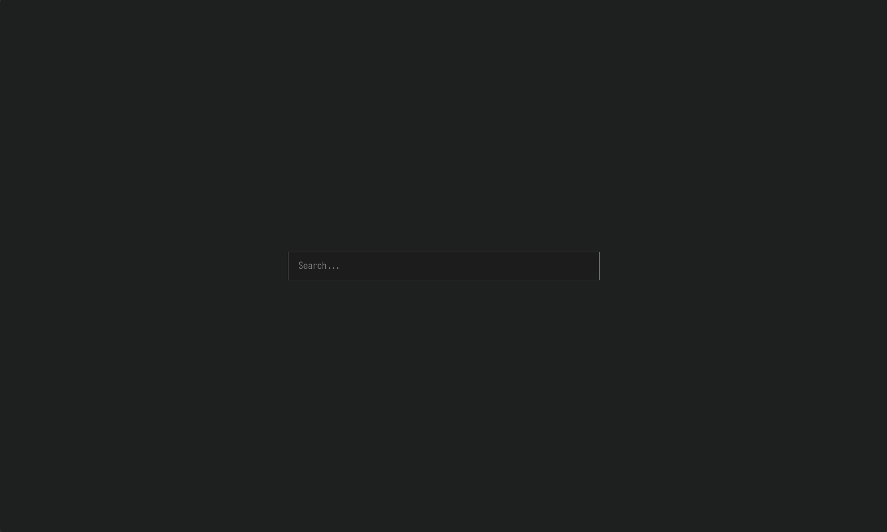
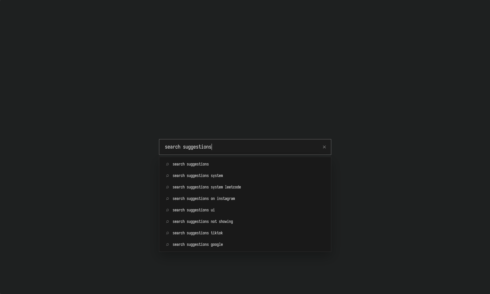
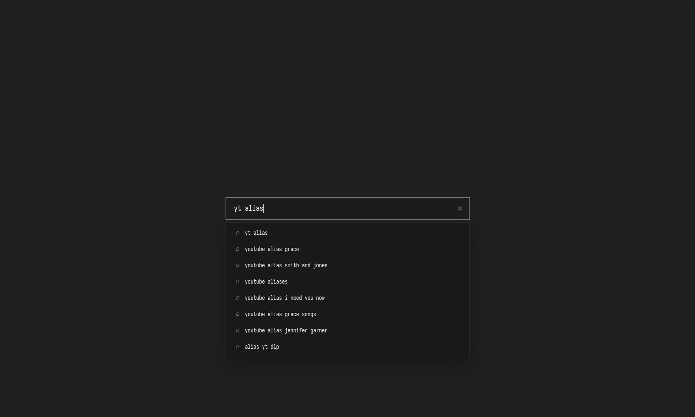

# Minimal Browser Homepage

A minimal, customizable browser homepage available as a Chrome extension and a standalone website. Features include Google search, search suggestions, configurable search aliases, customizable keyboard shortcuts, and a modular plugin system.

## Preview


## Screenshots

| Homepage |
|---|
|  | 
| Search Suggestions | 
| |
|Search Alias |
|  |


## Keyboard Shortcuts

| Shortcut | Action |
|---|---|
| `Alt + Y` | Open YouTube |
| `Alt + G` | Open GitHub |
| `/` | Focus the search bar |
| `Esc` | Hide suggestions or clear the search |

You can also start typing anywhere on the page to focus the search bar.

## Default Aliases

Aliases let you search specific websites directly from the homepage.

| Alias | Action |
|---|---|
| `yt query` | Search YouTubefor entered query |
| `ch query` | Open ChatGPT with entered query |

*Available aliases depend on your `aliases.conf` configuration.*


## Customization

### Customize Keyboard Shortcuts

Open `plugins/shortcuts/shortcuts.conf`.

Each line maps a key to a website URL:

```ini
Y = https://youtube.com
G = https://github.com
R = https://reddit.com
```

- Add a new line to create a shortcut.
- Change the URL to modify a shortcut.
- Delete a line to remove a shortcut.
- Use a single letter or number as the shortcut key.

Shortcuts use `Alt + key`. For example, `R = https://reddit.com` opens Reddit with `Alt + R`.

### Customize Search Aliases

Open `plugins/aliases/aliases.conf`.

Each line maps an alias to a URL:

To create an alias for a direct search, use a URL template containing the search-query placeholder.

For example:

```ini
yt = https://www.youtube.com/results?search_query={query}
```

#### Find Direct-Search URLs

You can find search URL templates for many websites in Helium's bangs list :

Open [Helium's bangs.json](https://services.helium.imput.net/bangs.json), press `Ctrl + F`, and enter the website's name to find its search URL template.


### Customize the Cursor

Open `style.css` and find the **Cursor Visibility** section.

To hide the blinking cursor, comment out this line:

```css
#search:focus {border-color: var(--border-focus);caret-color: var(--text);}
```

## Plugins

The homepage uses a modular plugin system. Plugins can be enabled or disabled through `plugins/plugins.conf`, allowing optional features to be kept separate from the core homepage.

### Enable or Disable a Plugin

Open `plugins/plugins.conf`.

For example:

```ini
shortcuts = plugins/shortcuts/shortcuts.js
aliases = plugins/aliases/aliases.js
```

- Add an entry to enable a plugin.
- Remove or comment out an entry to disable it.
- Each entry maps a plugin name to its JavaScript file.

### Create Your Own Plugin

1. Create a folder inside `plugins/` for your feature.
2. Add a JavaScript file for the plugin.
3. Export an asynchronous or synchronous `init()` function.
4. Register the plugin in `plugins/plugins.conf`.

Example folder structure:

```text
plugins/
├── plugins.conf
├── shortcuts/
│   ├── shortcuts.js
│   └── shortcuts.conf
├── aliases/
│   ├── aliases.js
│   └── aliases.conf
└── example/
    └── example.js
```

Example `example.js`:

```javascript
export function init() {
    console.log("Example plugin loaded!");
}
```

Enable it in `plugins/plugins.conf`:

```ini
example = plugins/example/example.js
```

The plugin loader imports enabled modules and calls their exported `init()` function.

### Plugin Development

- Keep each feature in its own folder.
- Store user-editable settings in separate `.conf` files when practical.
- Use `chrome.runtime.getURL()` to fetch files packaged with the browser extension. For cross-environment compatibility, use conditional resource loading:

  ```javascript
  const response = await fetch(
      typeof chrome !== "undefined" &&
      chrome.runtime &&
      typeof chrome.runtime.getURL === "function"
          ? chrome.runtime.getURL(CONFIG_PATH)
          : new URL(CONFIG_PATH, document.baseURI).href
  );
  ```

- Handle missing configuration files and invalid settings gracefully.
- Avoid modifying core homepage files when a feature can be implemented as a plugin.
- Reload the extension after making changes. For website changes, refresh the page or redeploy if necessary.

## Project Structure

```text
extension/
├── manifest.json
├── index.html
├── script.js
├── style.css
└── plugins/
    ├── plugins.conf
    ├── shortcuts/
    │   ├── shortcuts.js
    │   └── shortcuts.conf
    └── aliases/
        ├── aliases.js
        └── aliases.conf
```

Your project may contain additional files as new features are added.

## Installation

1. Download or clone this repository.
2. Open `chrome://extensions` in your Chromium-based browser.
3. Enable **Developer mode**.
4. Click **Load unpacked**.
5. Select the folder containing `manifest.json` (`extension` folder).
6. Open a new tab to use your homepage.

After editing extension files, click the **Reload** icon on its card to apply changes.
